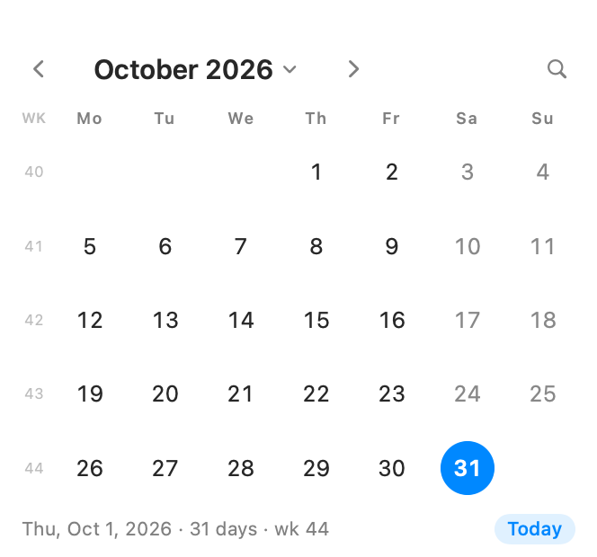

# Simple Calendar

A tiny macOS calendar that shows a month and nothing else — no events, no accounts,
no reminders. Made for one job: glancing at the month or looking up a date quickly.



## Build and run

```bash
cd ~/simple-calendar
./build.sh --run
```

That produces `dist/Simple Calendar.app`. Drag it to `/Applications` (or anywhere)
and launch it like any other app. It's signed ad-hoc and built locally, so Gatekeeper
opens it without complaints.

Re-run `./build.sh` after changing the source; `--run` opens it when the build finishes.

## Finding the month or day you want

| What you want | Fastest way |
| --- | --- |
| Next / previous month | `←` / `→`, the `‹ ›` buttons, or scroll/swipe on the grid |
| Next / previous year | `↑` / `↓` (or `⌘[` / `⌘]` for months, `⌘⇧[` / `⌘⇧]` for years) |
| Jump to a month or year | Click the month name for a month/year picker |
| Jump to anything by typing | `/` (or `⌘K`, or the magnifier) then type |
| Back to today | `T`, or the **Today** pill, or `⌘T` |
| A specific day's details | Click the day — the footer shows its weekday, date, week number and how far it is from today |

The search field understands all of these (the line underneath previews the result
before you press Return):

```
jul            → July, current year
mar 2027       → March 2027
2027           → same month, next year
sept           → September
12/25  25/12   → 25 December
14 mar 2027    → that day
feb 30         → clamps to the 28th
today          → today
```

Typing a digit anywhere opens the search field with that digit already in it, so
`2 0 2 7` `↵` is four keystrokes.

## Navigation keys

| Key | Action |
| --- | --- |
| `←` / `→` | Previous / next month |
| `↑` / `↓` | Previous / next year |
| `⇧←` `⇧→` | Move the selected day by one day |
| `⇧↑` `⇧↓` | Move the selected day by one week |
| `T` | Today |
| `/` or `⌘K` | Search field |
| `Esc` | Close the search field, or clear the selection |
| `h` `j` `k` `l` | Vim-style month navigation |

## Options

In the **Calendar** menu (or by right-clicking the window):

- Week starts on Sunday or Monday
- Show ISO week numbers down the left edge
- Keep the window on top

Your choices are remembered.

## Project layout

```
Sources/SimpleCalendar/
  App.swift          app + menu commands
  ContentView.swift  header, search field, weekday row, footer, month picker
  MonthGridView.swift  the grid and its day cells
  CalendarModel.swift  all state: displayed month, selection, layout, footer text
  JumpParser.swift   turns typed text into a date
  Keyboard.swift     pure key→action mapping (testable without a window)
  AppDelegate.swift  key/scroll monitors, window tweaks, snapshot mode
  Support.swift      Ref<T>, a stand-in for @State (see below)
scripts/             icon generator, logic tests
test.sh              runs the logic checks
build.sh             compiles + assembles the .app bundle
```

### Notes for future edits

- **No Xcode is installed here**, only the Command Line Tools, so `build.sh` uses
  `swiftc` directly and assembles the bundle by hand. It targets macOS 14+.
- `@State` is a compiler macro in the macOS 27 SDK and its plugin ships only with
  Xcode. This machine's toolchain doesn't have it, so the app uses
  `@StateObject` with the tiny `Ref` box instead. `@StateObject`, `@FocusState`,
  `@EnvironmentObject` and `@Published` are ordinary structs and work fine.
- `./test.sh` runs the parser, grid, navigation and keyboard checks with no GUI.
- To preview the layout without screen access:
  `"dist/Simple Calendar.app/Contents/MacOS/SimpleCalendar" --snapshot /tmp/cal.png`
  (add `--month 2026-08`, `--weeks`, `--monday`, or `--jump "dec 2027"`).
